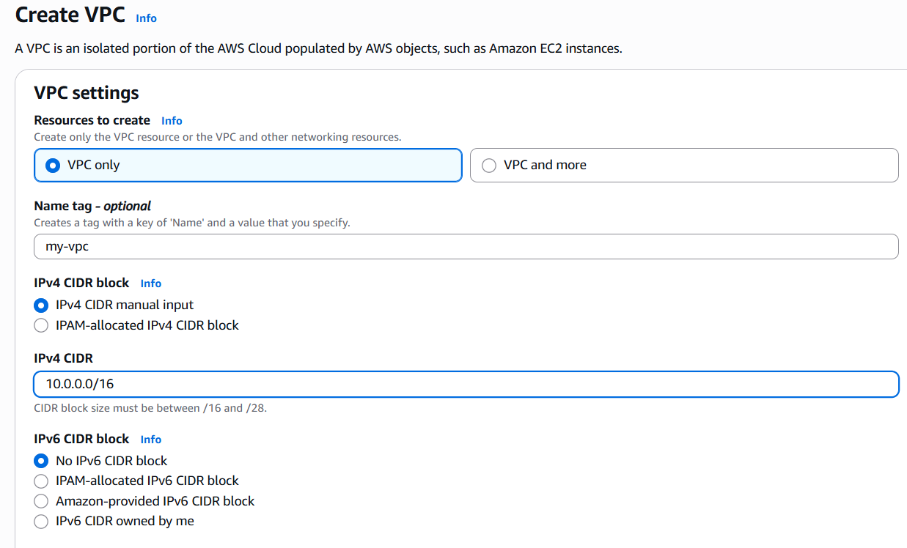

# AWS Web Application Network Architecture

## Project Overview

This project demonstrates a secure and highly available AWS network architecture for hosting a web application across two Availability Zones (AZs).

The architecture uses:

- Custom Amazon VPC

- Two Availability Zones

- Public and private subnets

- Internet Gateway (IGW)

- NAT Gateway

- Route Tables

- Security Groups

- Web/Application servers

- Database layer

## Architecture Diagram

```
             my-vpc
          10.0.0.0/16
              |
       +------+------+
       |             |
    us-east-1a    us-east-1b
       |             |
 Public Subnet    Private Subnet
       |             |
       |          EC2/App
       |
   NAT Gateway
       |
   Internet Gateway
       |
    Internet

```

## AWS Architecture

<h2>1. VPC</h2>

A custom VPC is created with the CIDR:

```
10.0.0.0/16
```

This provides the private network space for the application.

The VPC is divided into multiple subnets across two Availability Zones.

<h3>Process:</h3> 

Go to VPC > Your VPC's > click "Create VPC"
 
 

 settings :

 - select VPC only 
 - set name of your vpc
 - Mention CIDR (in this case 10.0.0.0/16)

After above settings are done click "create VPC"

<h2>2. Subnets</h2>

I have created 2 subnets :

1. Public subnet
2. Private Subnet

Both subnets are created in 2 different Availability Zones.
In this case, public subnet is in us-east-1a and private subnet in us-east-1b.


<h3>Process:</h3>

Go to VPC > Subnets > click "Create Subnet" > select your newly created VPC as shown below :


Now set subnet settings as shown below :

<h4>1. Public Subnet Settings :</h4>

set name > select one AZ > set IPv4 subnet CIDR block 


after settings are done click "Add one more/new subnet " option

<b>Note :</b>

The IPv4 subnet cidr block text field tells user which block is relevant to use, choose that value for better understandin of how cidr is used , once understood you can mention your own cidr 

In this case, the text field recommended 10.0.0.0/20 hence i used the same


<h4>2. Private Subnet Settings :</h4>

set name > select one AZ > set IPv4 subnet CIDR block


<b>Note :</b>

here, while setting CIDR block of next subnet first mention the earlier CIDR block you used for previous subnet and then click ">"(greater than) sign

After Setting up both Subnets click "create subnets"

Subnets created seccessfully !


<h4>Important :</h4>

For Instances in public subnet get autotmatically assigned with public subnet , do following :


select your Public subnet > click "Actions" > under that click "Edit subnet settings" > enable the auto assign public IP opion.


<h2>3. Internet-Gateway</h2>

<b>What it does ?</b>

An Internet Gateway (IGW) is attached to the VPC.

It provides communication between resources in the VPC and the public internet.

The Internet Gateway is primarily used by resources in the public subnets.

<h3>Process :</h3>

Go to VPC > Internet Gateway > click "Create Internet Gateway" > set name > click "create Internet Gateway"


Now Attach Internet Gateway to VPC :

Now select "Actions" > select "Attach to VPC" > select your VPC > click "Attach Internet gateway"


successfully created and attached Internet Gateway to VPC:


<b>Note :</b>
wait until the state of Internet Gateway shows "Attached"

<h2>4. NAT Gateway :</h2>

<b>What it does ?</b>

A NAT Gateway allows resources in private subnets to initiate outbound connections to the internet without allowing unsolicited inbound internet connections directly to those private resources.

For example, an application server may need to:

- Download software packages

- Access AWS APIs

- Download updates

- Access external APIs

The traffic can flow through:

```
Private Server
     ↓
NAT Gateway
     ↓
Internet Gateway
     ↓
Internet
```

<b>Note :</b>
The internet cannot directly initiate a connection to the private application server through the NAT Gateway.

<h3>Process :</h3>

Go to VPC > NAT Gateway > click "Create NAT Gateway" > set name > select "Zonal" > select your created public subnet > allocate elastic IP for that click "Allocate Elastic IP" given aside


successfully Created NAT Gateway :


<h2>5. Route Tables :</h2>

<b>What it does ?</b>

Route tables determine where network traffic should be sent.

<h3>1.Public Route-Table</h3>

Go to VPC > Route Tables > go inside your VPC's main route table > under "Routes" tab > click "Edit Routes" >add routes as shown in screenshots > click "save changes"


The public subnet's route table must contain following routes :

```
Destination       Target

10.0.0.0/16       local
0.0.0.0/0         my-igw
```


The important route is:
```
0.0.0.0/0 → my-igw(Internet gateway you created)
```

This sends internet-bound traffic through the Internet Gateway. 


<b>Note :</b>
Here, i have used VPC's main route table as public route table


<h3>2.Private Route-Table</h3>

I have separately created private route table.

Go to VPC > Route Tables > click "Create Route Table" > set name >select your vpc > click "Create Route Table" > go inside your private route table > under "Routes" tab > click "Edit Routes" >add routes as shown in screenshots > click "save changes"


The public subnet's route table must contain following routes :

```
Destination       Target

10.0.0.0/16       local
0.0.0.0/0         my-Nat
```


The important route is:
```
0.0.0.0/0 → my-Nat (your created NAT-Gateway)
```

This sends internet-bound traffic from private resources through the NAT Gateway.

<h2>6. Explicit Subnet Associations :</h2>

<b>What it is ?</b>

Explicit subnet association means you manually tell AWS which route table a particular subnet should use.

by default both private and public subnets are associated with main route table of vpc.

We need to explicitly associate private subnet to private route table.

without doing this the private subnet will use public route table which is risky.

<h3>Process :</h3>

Go to vpc > Route Tables > select your private route table you created > under "subnet associations" tab > click "Edit Subnet Associations" > next select your private table > click "save associations"


<h2>6. Verify your VPC architecture :</h2>

It should look something like :


<h2>7. launching EC2 Instance :</h2>

<h3>1. launching public-server</h3>

Go to EC2 > instances > click "launch instance" > set name > select AMI >select instance type(select free tier) > select key pair > in network settings click "edit" > select your vpc > select subnet (public subnet) > Security group settings : you can either create new security group or select existing one(here i have created new one) > click "launch instance"


<b>Security Group :</b>

In this security group i have only allowed SSH/22 rule


we can also add ports like 80,443,3306 etc and custom ports

<h3>1. launching private-server</h3>

Go to EC2 > instances > click "launch instance" > set name > select AMI >select instance type(select free tier) > select key pair > in network settings click "edit" > select your vpc > select subnet (private subnet) > Security group settings : i have selected existing one(same security group as of public server) > click "launch instance"


successfully launched public and private servers in public and private subnets :


verify :

<b>Important :</b>

when you launch an instance inside public subnet it must get automatically assigned with public IP, no manual efforts should be taken .

when instances get automatically assigned with Public IPs everytime the're launched then you public subnet is configured correctly.


when you launch an instance inside private subnet it must get only assigned with private IP, no public IP must be assigned to it


Here , we have successfully built AWS VPC Architecture

Author,
 
Vaidehi Gawde


